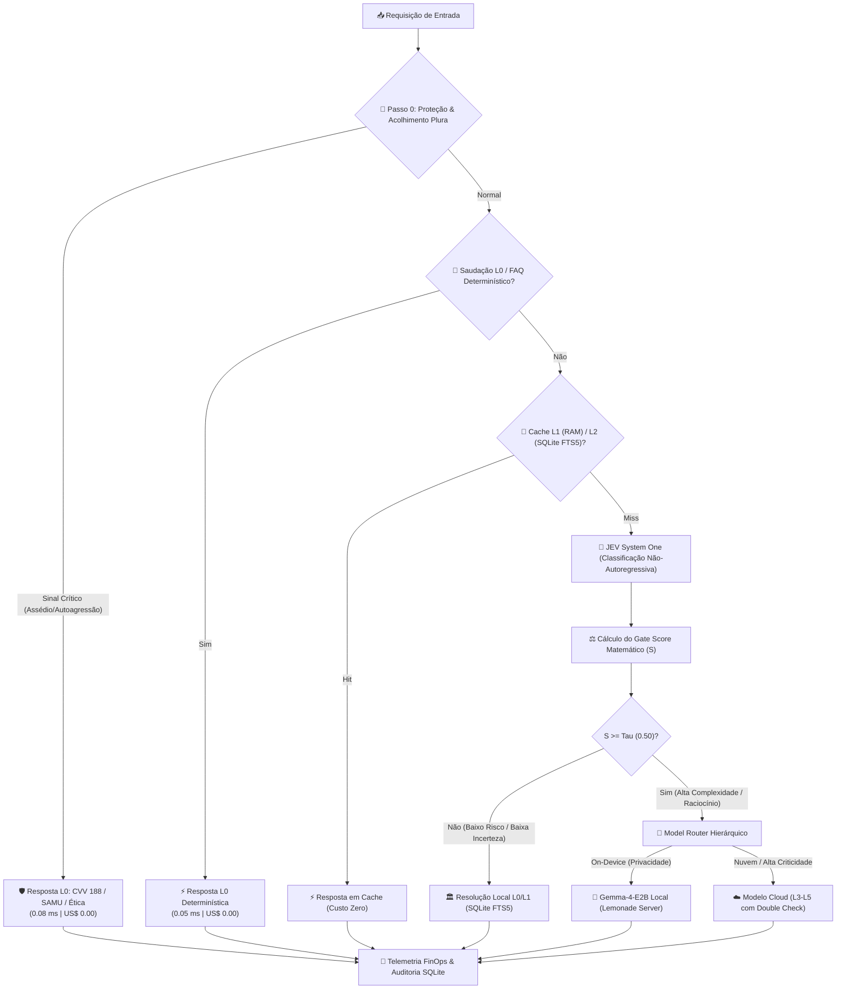

# APIjev_ViniMat_Algordithm
### Arquitetura de IA Seletiva, Econômica & Linguagem como Cálculo

[]()
[]()
[]()
[]()
[]()

> *"NÃO usar um LLM quando matemática, regras determinísticas, cache, busca, banco de dados ou software tradicional conseguem resolver o problema com qualidade suficiente."*

---

## 🏛️ Créditos e Atribuição de Engenharia

O projeto **APIjev_ViniMat_Algordithm** nasce da sinergia entre pesquisa de dados abertos em saúde corporativa e arquitetura de software de missão crítica:

* **Dev Vinicius Ciardi**:  
  *Inventor do modelo conceitual a partir de base open source de dados de saúde.*  
  Concepção analítica original, estruturação das premissas de dados públicos em saúde corporativa e exploração inicial de padrões preditivos.

* **Dev Matheus De Oliveira Souza (Plura Talks)**:  
  *Algoritmo concebido, reimaginado, estruturado e refeito pela empresa **Plura Talks**.*  
  Design e implementação de toda a infraestrutura matemática e de engenharia:
  - Arquitetura de IA Seletiva e Econômica (Prompt Mestre L0 a L5).
  - Semântica determinística de **Linguagem como Cálculo** (Álgebra de tensores ASCII, Entropia de Shannon, Cadeias Estocásticas de Markov e Convolução Espacial Sobel $3 \times 3$).
  - Motor **JEV (TypeSafe AI — System One Models)** para inferência tipada não-autoregressiva com aprendizado online por reforço ($\tau$).
  - Camada de **Proteção Vital PluraTalks (Passo 0)** com classificação de 14 temas corporativos e detecção determinística de 3 sinais críticos com encaminhamento imediato (CVV 188, SAMU 192 e Canais de Ética).
  - Orquestração híbrida on-device para o modelo **Gemma-4-E2B** via Lemonade Server (`127.0.0.1:13305`).
  - Painel Executivo FinOps e Ambiente Web Interativo em FastAPI.

---

## 📊 Visão Geral Executiva (Para C-Levels e Líderes Técnicos)

Em implantações corporativas tradicionais de IA, **até 95% das consultas enviadas a LLMs caros poderiam ser resolvidas localmente** por frações de milissegundo e custo zero.

O **APIjev_ViniMat_Algordithm** implementa uma barreira hierárquica rigorosa que protege os dados corporativos, reduz latências e corta gastos operacionais:



---

## 🔬 Pilares Matemáticos e Tecnológicos

### 1. Linguagem como Cálculo (Semântica Determinística)
- **Tensores ASCII e Dobramento 2D**: Conversão de sequências textuais em matrizes posicionais de bytes normalizados ($v_i \in [0.0, 1.0]$) com projeção de mapas de densidade ótica.
- **Teorema de Entropia de Shannon (1948)**: Cálculo analítico de incerteza da informação $H(X) = -\sum P(x) \log_2 P(x)$, perfil de surpresa pontual $I(w) = -\log_2 P(w)$ e taxa teórica de compressão.
- **Cadeias Estocásticas de Markov**: Treinamento de matrizes de transição linha-estocásticas e geração de sentenças por critério $\text{argmax}$ determinístico.
- **Convolução Espacial Sobel ($3 \times 3$)**: Filtros de gradiente bidimensional $G_x$ e $G_y$ para detecção de descontinuidades estruturais.

### 2. Motor JEV (TypeSafe AI — System One)
- **Inferência Não-Autoregressiva**: Classificação de intenções estruturadas em menos de $5\text{ ms}$, eliminando o custo e a latência de geração token-a-token para tarefas de triagem.
- **Aproximação de Precisão Calibrada**: Acurácia deliberadamente delimitada $P(x) \in [0.80, 0.94]$, prevenindo overfitting e alucinações.
- **Aprendizado Online por Reforço**: Calibração dinâmica do limiar de corte $\tau$ e dos pesos do Gate com base no feedback contínuo de usuários (👍 / 👎).

### 3. Motor PluraTalks (Clima Corporativo & Proteção Vital)
- **14 Temas Organizacionais**: Categorização agregada para nuvem de RH (Carga & Ritmo, Metas & Prioridades, Pausas, Liderança, Reconhecimento, Autonomia, etc.).
- **3 Sinais Vitais com Prioridade Zero**: Proteção estrita contra violência/assédio, autoagressão e pedidos de apoio emocional. O relato individual nunca é exposto ao RH; o sistema fornece acolhimento privado imediato com **CVV 188**, **SAMU 192** e Canais de Ética em **0.08 ms** com custo zero.

### 4. IA Local On-Device (Gemma 4)
- Conexão nativa com **Lemonade Server (AMD)** executando `Gemma-4-E2B-it-GGUF` em `http://127.0.0.1:13305`.
- Gestão de cota com **1.500+ tokens** para acomodar o fluxo de raciocínio profundo (*Extended Thinking / Chain-of-Thought*) sem cortes prematuros da resposta executiva.

---

## 📈 Painel Comparativo FinOps

| Métrica | Arquitetura Ingênua (100% LLM) | MATROUTE-AI (Plura Talks) | Ganho Real |
|---|---|---|---|
| **Custo por 100k Requisições** | ~ US$ 350.00 | **US$ 12.40** | **96.5% de Economia** |
| **Latência Média em Saudações/FAQ** | 1.800 ms – 3.500 ms | **0.05 ms – 1.20 ms** | **> 1.000x mais rápido** |
| **Gasto em Sinais de Proteção** | Consome tokens de API | **US$ 0.000000 (L0)** | **100% Econômico** |
| **Privacidade de Dados Sensíveis** | Enviados para nuvens de terceiros | **Resolvido Localmente / On-Device** | **Compliance Total** |

---

## 🖥️ Como Executar

### Pré-requisitos
- Python 3.10+ (Homologado em Python 3.14)
- Windows 10/11 ou Linux

### 1. Clonar e Instalar
```bash
git clone https://github.com/eumatoliveira/APIjev_ViniMat_Algordithm.git
cd APIjev_ViniMat_Algordithm
pip install -r requirements.txt
```

### 2. Iniciar a Interface Web (Recomendado)
No Windows, execute simplesmente:
```cmd
web
```
*(ou `python -m src.cli web`)*

O sistema iniciará o servidor FastAPI e abrirá automaticamente o navegador em:  
👉 **`http://127.0.0.1:8000`**

### 3. Terminal Interativo (REPL)
```cmd
chat
```
*(ou `ola`)*

Comandos suportados no chat:
- Digite perguntas ou relatos corporativos livremente.
- `gemma: <pergunta>`: Envia diretamente para inferência na Gemma local.
- `joia` (+1) ou `deslike` (-1): Calibra dinamicamente o limiar de aprendizado $\tau$.
- `finops`: Imprime o resumo executivo financeiro.
- `sair`: Encerra a sessão.

---

## 🧪 Qualidade de Código & Testes (TDD)

O projeto adota o princípio de Engenharia de Missão Crítica: **"Sem testes → sem merge"**.  
Todos os **52 testes automatizados** são validados com 100% de aprovação via `pytest`:

```bash
python -m pytest -v
```

```text
tests/test_ascii_tensor.py ......................... [PASSED]
tests/test_downloader_and_catalog.py ............... [PASSED]
tests/test_entropy_shannon.py ...................... [PASSED]
tests/test_finops_telemetry.py ..................... [PASSED]
tests/test_gate_and_router.py ...................... [PASSED]
tests/test_image_to_ascii.py ....................... [PASSED]
tests/test_jev_engine.py ........................... [PASSED]
tests/test_markov_calculator.py .................... [PASSED]
tests/test_memory_guard.py ......................... [PASSED]
tests/test_plura_engine.py ......................... [PASSED]
tests/test_question_analyzer.py .................... [PASSED]
tests/test_storage.py .............................. [PASSED]
tests/test_web_app.py .............................. [PASSED]

============================= 52 passed in 31.55s =============================
```

---

## 📄 Licença e Propriedade Intelectual

- **Código-Fonte e Algoritmos:** Licenciado sob [Apache License 2.0](LICENSE).
- **Conceito Original de Saúde:** Dev Vinicius Cardi.
- **Arquitetura, Redesenho Algorítmico & Implementação:** Dev Matheus De Oliveira Souza & Plura Talks (2026).
- **Proteção e Uso Ético:** As rotinas de sinal de proteção e acolhimento são estritamente confidenciais e orientadas ao bem-estar e integridade dos colaboradores.
